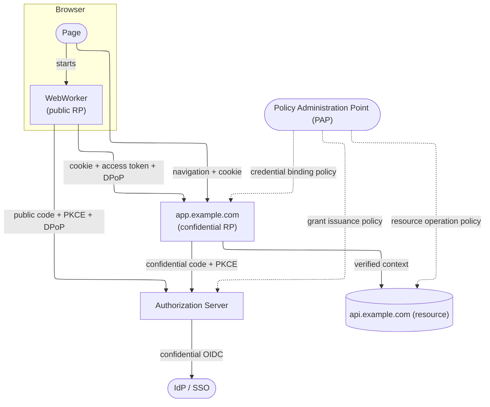

# Joint Authorization

Edge-managed, HttpOnly, host-only session cookies protect application delivery
and provide baseline access. These cookies remain bearer credentials: a stolen
cookie can be replayed while the edge accepts the session.

A public client using ACF with PKCE can obtain DPoP-bound API tokens, with a
WebWorker retaining the signing key through WebCrypto. This reduces the
usefulness of stolen tokens for sensitive or mutating operations.

However, a worker-only design cannot authenticate the initial navigation needed
to load the worker. It therefore requires an unauthenticated bootstrap and makes
protected content or operations depend on browser-side grant initialization.

Joint authorization preserves protected application delivery and baseline access
through the edge RP session, while requiring an additional worker credential for
designated operations.



- The edge RP session protects the application shell and permits baseline access
  without a worker grant.
- The edge RP and worker use separate OAuth client IDs, grants, and refresh
  tokens, with independently managed authorization and refresh flows.
- Designated operations require an accepted edge session, a valid
  resource-specific worker token, and a valid DPoP proof, associated with the
  same authorized user, tenant, and application context.
- The authorization server independently authorizes worker-grant issuance and
  may reuse the existing SSO session.
- The app edge evaluates credential-binding policy when both credentials are
  presented; the API enforces resource-operation policy through the trusted
  ingress path.
- Dotted connections represent policy delivery with independently bounded cache
  lifetimes, rather than a network lookup on every request.

## Value / Cost Summary

| Dimension       | Value                                                                                                               | Cost or condition                                                                                                |
| --------------- | ------------------------------------------------------------------------------------------------------------------- | ---------------------------------------------------------------------------------------------------------------- |
| Security        | A stolen RP cookie alone cannot authorize designated operations. A stolen worker token also requires its proof key. | Grant issuance must preserve that separation. Active malicious code in the browser remains a threat.             |
| User experience | Protected application delivery works immediately through the RP session.                                            | Sensitive operations may wait for a second authorization flow, refresh, or stronger authentication.              |
| Scalability     | Policy distribution and local evaluation can avoid a central policy request on every operation.                     | Replay detection, session state, revocation, and policy freshness require explicit distributed-system decisions. |
| Performance     | Baseline navigation can avoid worker initialization. Steady-state checks can run at the existing edge.              | Protected requests add signing, proof verification, headers, and potentially replay-store access.                |

## Authorization Policy Layout

The model described above has three policy enforcement points (PEPs):

1. The application, relying party (RP) edge;
2. The authorization server; and,
3. The upstream resource server.

### Application Edge Attributes

- **Accepted RP session** — issuer and subject, application and tenant context,
  and authentication time or assurance level when recorded in the validated
  session.
- **Matched route** — configured application, tenant, HTTP method, upstream
  resource, and whether the route requires joint authorization or permits
  baseline session access.
- **Validated worker credential** — token issuer, subject, audience, OAuth
  client ID, granted scopes, and issuer-asserted tenant where available. Compare
  the credentials using a trusted account mapping if the issuer uses distinct
  subject identifiers for the two clients. Check the worker client and audience
  against the application and route configuration.
  [RFC 9068](https://www.rfc-editor.org/rfc/rfc9068.html#section-2.2),
  [OIDC Core](https://openid.net/specs/openid-connect-core-1_0.html#SubjectIDTypes)
- **Verified proof of possession** — proof key matches the token binding, token
  hash matches the presented token, method and URI match the incoming request,
  and the proof satisfies freshness and applicable replay checks.
  [RFC 9449](https://www.rfc-editor.org/rfc/rfc9449.html#section-4.3)

### Authorization Server Attributes

The authorization server enforces grant issuance policy using validated upstream
IdP/SSO assertions and its own client and grant records.

- **Authenticated account** — issuer-local user ID, account status, tenant
  memberships, and roles or groups from the IdP or its trusted directory.
- **SSO authentication context** — authentication time, methods, and assurance
  level when available, used to decide whether the existing login suffices or
  fresh or stronger authentication is required.
  [OIDC Core](https://openid.net/specs/openid-connect-core-1_0.html#IDToken)
- **Registered client** — client ID and type, registered redirect URI, permitted
  grant types, and the application's allowed tenants, resources, and scopes.
  Check the requested grant against the registration and enforce PKCE for the
  public client.
  [RFC 9700](https://www.rfc-editor.org/rfc/rfc9700.html#section-2.1)
- **Grant request** — requested resource, scopes, and tenant if applicable.
  Evaluate these against client permissions, user entitlements, and consent
  where required. At token issuance, use the validated DPoP proof key to bind
  the worker token.
  [RFC 8707](https://www.rfc-editor.org/rfc/rfc8707.html#section-2),
  [RFC 9449](https://www.rfc-editor.org/rfc/rfc9449.html#section-5)

### Resource Server Attributes

- **Caller context from trusted ingress** — verified user, tenant, application,
  credential checks satisfied, and granted scopes where applicable. Accept this
  context only from the authorized app edge, with browser-supplied identity
  headers removed at ingress.
- **Requested operation** — API handler and action, such as read, update, or
  approve, plus the target object and affected fields resolved from the request.
- **Authoritative resource data** — owning tenant, owner, sharing permissions,
  classification, and workflow state from the resource server's own data or a
  trusted service. Use these attributes to check the action on the specific
  object, including tenant boundaries and any field-level restrictions.
  [NIST SP 800-162](https://csrc.nist.gov/pubs/sp/800/162/upd2/final),
  [OWASP API1](https://owasp.org/API-Security/editions/2023/en/0xa1-broken-object-level-authorization/)

## Example Credential-Binding Policy

### Policy Data Schema

```typescript
type PolicyData = {
  edge: {
    client_id: string;
    audience: string;
  };
  jwt: {
    issuer: string;
    algorithms: Array<'ES256' | 'RS256'>;
    clock_skew_seconds: number;
  };
  dpop: {
    algorithms: Array<'ES256'>;
    max_age_seconds: number;
    clock_skew_seconds: number;
  };
  resources: {
    [resource: string]: {
      worker_client_ids: string[];
    };
  };
};
```

### Example Policy Data

```json
{
  "edge": {
    "client_id": "https://app.example.com/oauth/client.json",
    "audience": "https://app.example.com"
  },
  "jwt": {
    "issuer": "https://auth.example.com",
    "algorithms": ["ES256"],
    "clock_skew_seconds": 5
  },
  "dpop": {
    "algorithms": ["ES256"],
    "max_age_seconds": 60,
    "clock_skew_seconds": 5
  },
  "resources": {
    "https://api.example.com/billing": {
      "worker_client_ids": ["https://app.example.com/worker-client.json"]
    },
    "https://api.example.com/reports": {
      "worker_client_ids": ["https://app.example.com/worker-client.json"]
    }
  }
}
```

### Evaluation Input Schema

```typescript
type AccessToken = {
  header: { alg: string; typ: string };
  claims: {
    iss: string;
    sub: string;
    aud: string[];
    client_id: string;
    exp: number;
    iat: number;
    nbf?: number;
    jti: string;
  };
};

type PolicyInput = {
  edge: {
    client_id: string;
    resource: string;
    now: number;
    method: string;
    uri: string;
  };
  edge_rp: AccessToken;
  worker_rp: AccessToken & {
    claims: { cnf: { jkt: string } };
    access_token_hash: string;
    dpop: {
      header: { alg: string; typ: string };
      claims: {
        jti: string;
        htm: string;
        htu: string;
        iat: number;
        ath: string;
        nonce?: string;
      };
      key_thumbprint: string;
    };
  };
};
```

### `joint_authorization.rego`

```rego
package joint_authorization

import rego.v1
import data.credentials.jwt
import data.credentials.dpop

default allow := false

allow if {
  input.edge.client_id == data.edge.client_id
  resource := data.resources[input.edge.resource]

  input.edge_rp.claims.client_id == data.edge.client_id
  input.worker_rp.claims.client_id in resource.worker_client_ids

  jwt.verify(input.edge_rp, data.jwt, data.edge.audience, input.edge.now)
  jwt.verify(input.worker_rp, data.jwt, input.edge.resource, input.edge.now)
  dpop.verify(input.worker_rp, input.edge, data.dpop)

  input.edge_rp.claims.sub == input.worker_rp.claims.sub
}
```

### `credentials/jwt.rego`

```rego
package credentials.jwt

import rego.v1

verify(credential, requirements, audience, now) if {
  credential.header.alg in requirements.algorithms
  credential.header.typ in {"at+jwt", "application/at+jwt"}
  credential.claims.iss == requirements.issuer
  audience in credential.claims.aud

  credential.claims.exp > now - requirements.clock_skew_seconds
  credential.claims.iat <= now + requirements.clock_skew_seconds
  object.get(credential.claims, "nbf", 0) <= now + requirements.clock_skew_seconds
}
```

### `credentials/dpop.rego`

```rego
package credentials.dpop

import rego.v1

verify(credential, request, requirements) if {
  proof := credential.dpop
  proof.header.typ == "dpop+jwt"
  proof.header.alg in requirements.algorithms
  credential.claims.cnf.jkt == proof.key_thumbprint
  proof.claims.ath == credential.access_token_hash
  proof.claims.htm == request.method
  proof.claims.htu == request.uri
  proof.claims.iat <= request.now + requirements.clock_skew_seconds
  proof.claims.iat >= request.now - requirements.max_age_seconds - requirements.clock_skew_seconds
}
```
