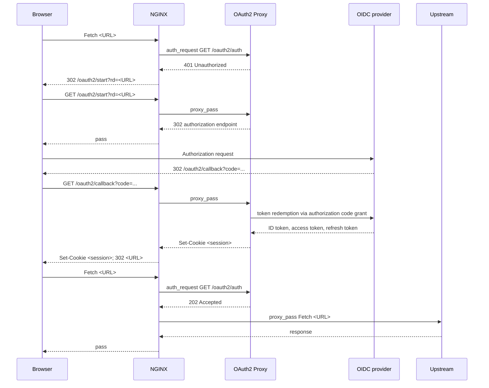
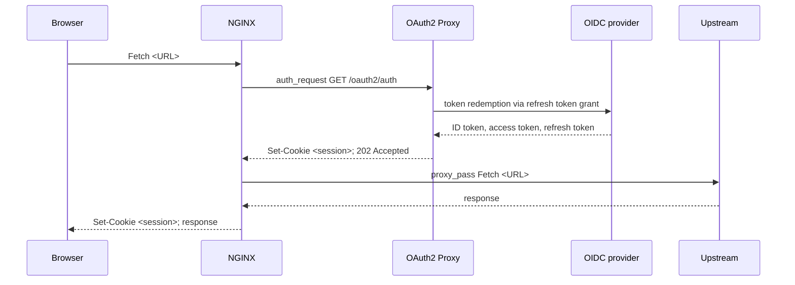
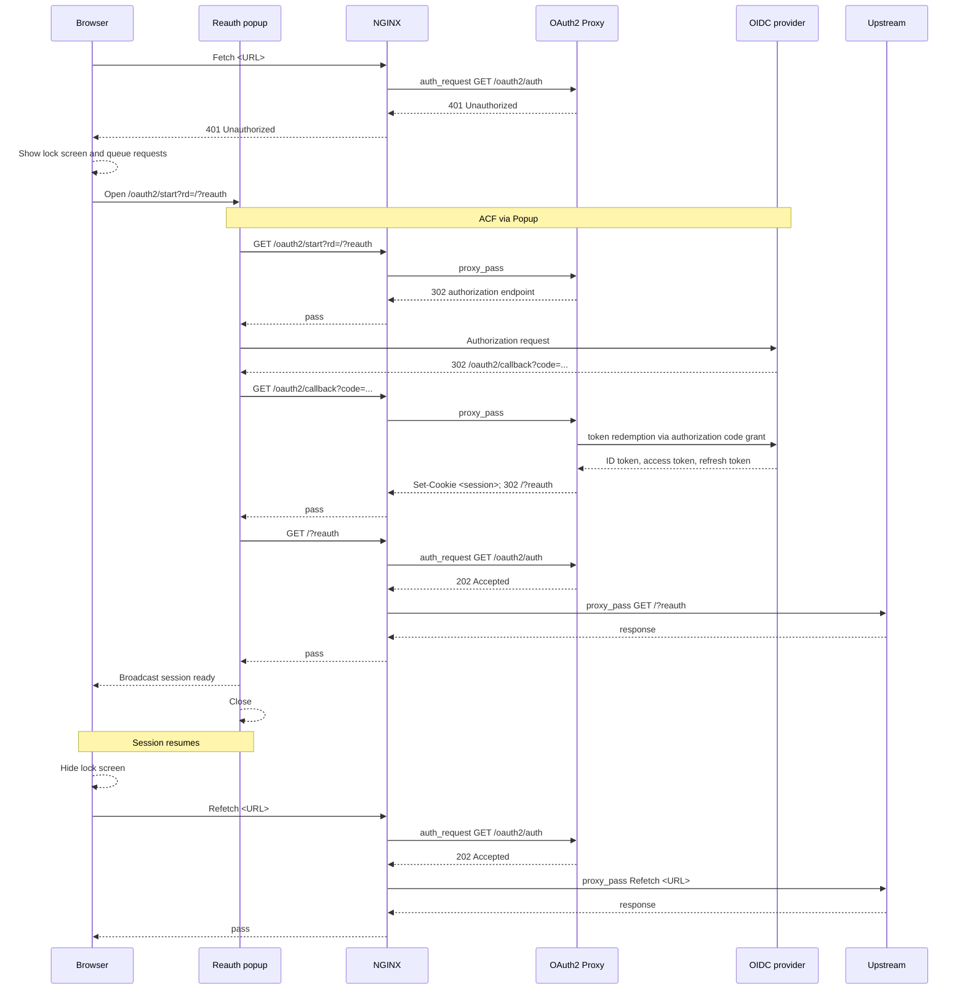
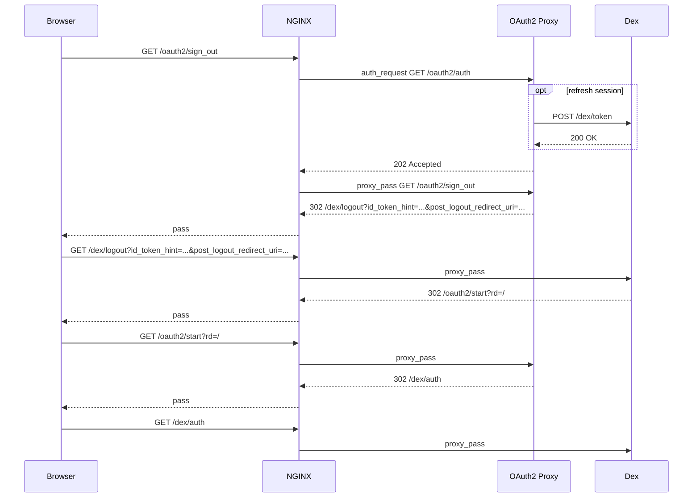
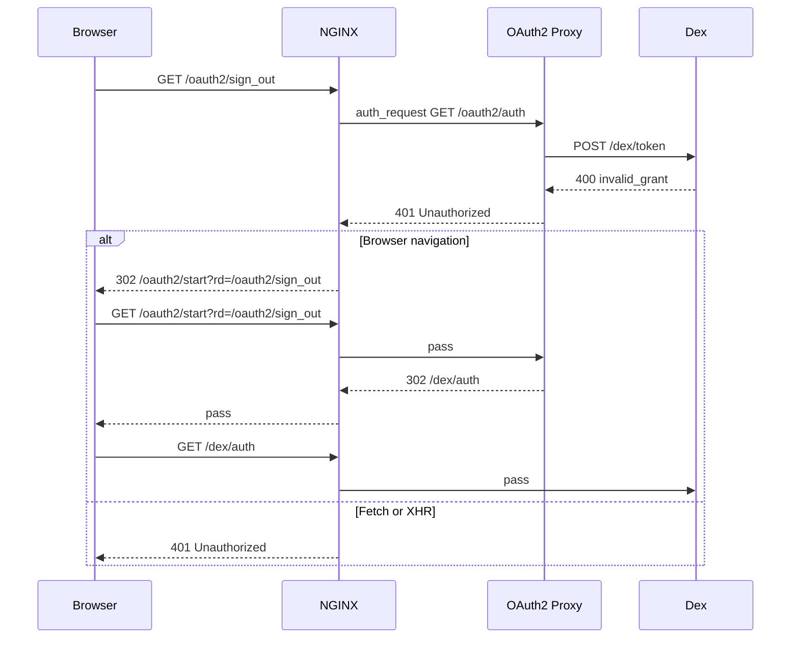
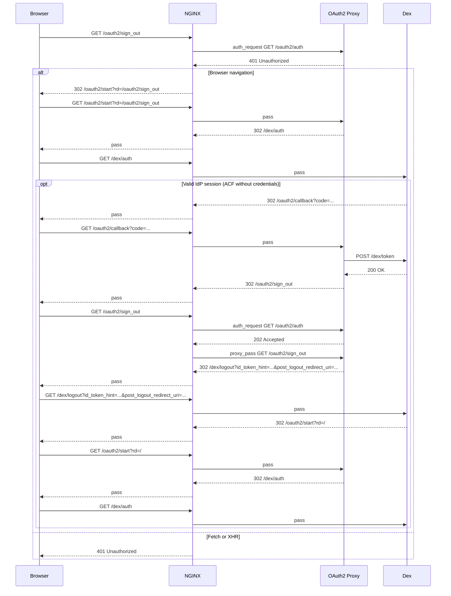

# Session Lifecycle

## Authorization Code Flow (ACF)

## Session Refresh

## Reauthentication via ACF Popup

## Managed Dex Sign-out

### Signout when the app session is accepted

### Signout when app session refresh is rejected

### Signout without an app session

