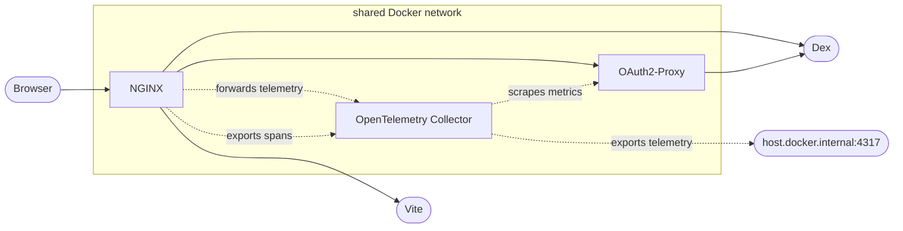

# Telemetry

Visage provides opt-in telemetry collection for its managed NGINX and OAuth2
Proxy services. Set `telemetry: {}` to run the managed OpenTelemetry Collector.

See the [telemetry example](../examples/telemetry) for how to configure Grafana
as a managed Visage service.

## Traces

When telemetry is enabled, Visage configures NGINX to export spans to the
OpenTelemetry Collector. The NGINX spans are configured with the following
resource attributes:

- `service.name=nginx`
- `service.namespace` set to the NPM package name
- `service.instance.id=${HOSTNAME}` (Docker container ID)
- `service.version=${NGINX_VERSION}`

## Metrics

When telemetry is enabled:

- OAuth2 Proxy serves Prometheus metrics at `nginx:4181`.
- The Collector scrapes OAuth2 Proxy's Prometheus metrics.
- The Collector converts NGINX spans to explicit bucket histograms.

## Logs

Compose lifecycle output is written to `logs/compose.log`. With telemetry
disabled, container output is followed into `logs/container.log` without
redaction. Logs live under `<Vite cacheDir>/visage` in plugin mode or
`<cwd>/.visage` in server mode.

When telemetry is enabled:

- Services send logs through Docker's Fluentd driver to the Collector while
  disabling `docker logs` to avoid writing sensitive values to disk.
- The Collector performs redaction of known sensitive values from NGINX and
  OAuth2 Proxy.
- The Collector exports telemetry via OTLP gRPC to `host.docker.internal:4317`.
- Services can export telemetry via OTLP gRPC and HTTP to `otelcol:4317` and
  `otelcol:4318`, respectively.
- Browsers may export telemetry via session cookie protected OTLP ingest
  endpoints under `/t/`.
