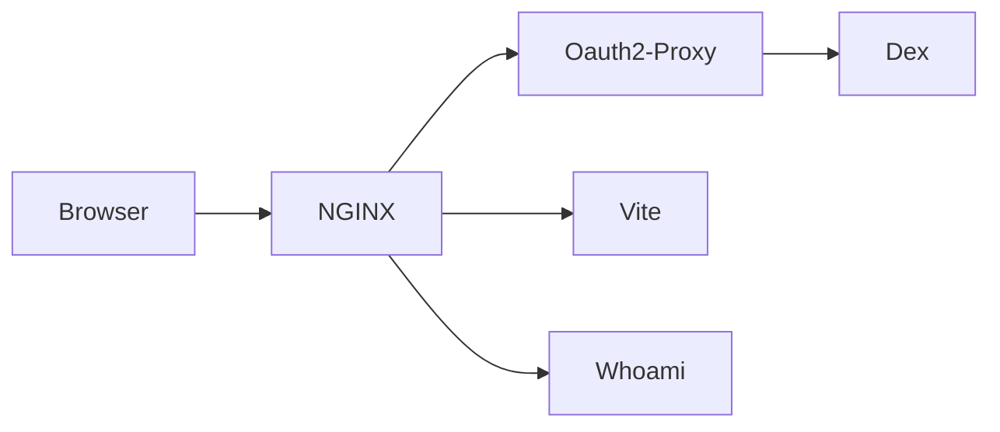

# Simple Example

Run `npm run dev --workspace examples/simple` from the repository root and open
`https://localhost:9001`. Sign in with `user@example.com` / `visage-password`.

## System Block Diagram

