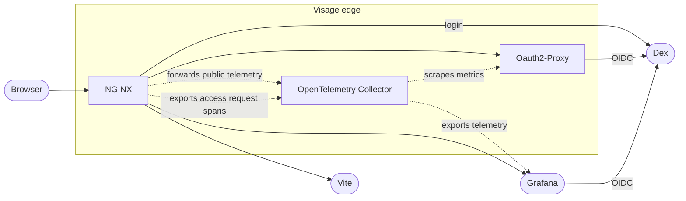

# Telemetry Example

Run `npm run dev --workspace examples/telemetry` from the repository root and
open `https://localhost:9001`. Sign in with `user@example.com` /
`visage-password`.

This example enables Visage's managed OpenTelemetry Collector and configures a
Grafana service available at `https://g.localhost:9001`.

Traces, metrics, and logs use 24-hour retention and persist across container
recreation in the `lgtm-data` named Docker volume. Dashboard files remain bind
mounted from `otel-lgtm/dashboards` so dashboard edits can be saved to the host.

The Collector:

- receives NGINX traces, container logs, and browser logs;
- scrapes OAuth2 Proxy metrics;
- derives request metrics from NGINX spans;
- and exports each signal over OTLP to LGTM.

Dex is configured as the IdP for OIDC SSO at `https://idp.localhost:9001`.
Grafana establishes an independent application session separate from Vite.
However, Grafana and Vite share the IdP session such that users may enter their
credentials only once while the IdP session remains valid.

## System Block Diagram

