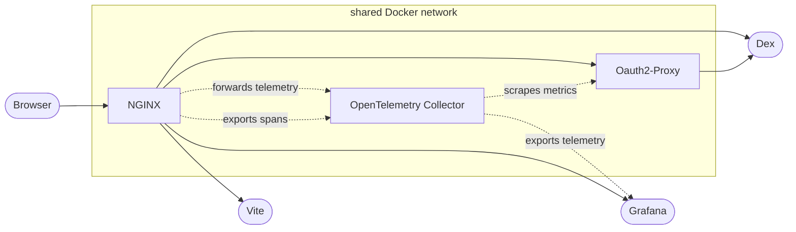

# Telemetry Example

Run `npm run dev --workspace examples/telemetry` from the repository root and
open `https://localhost:9001`. Sign in with `user@example.com` /
`visage-password`.

This example enables Visage's managed OpenTelemetry Collector and configures a
Grafana service available at `https://localhost:9001/grafana`.

Traces, metrics, and logs use 24-hour retention and persist across container
recreation in the `lgtm-data` named Docker volume. Dashboard files remain bind
mounted from `otel-lgtm/dashboards` so dashboard edits can be saved to the host.

The Collector:

- receives NGINX traces, container logs, and browser logs;
- scrapes OAuth2 Proxy metrics;
- derives request metrics from NGINX spans;
- and exports each signal over OTLP to LGTM.

Visage acts as the relying party between the browser user-agent and the IdP,
Dex. Visage forwards identity headers to Grafana; Grafana is configured to trust
the headers as user identity for authorization.

## System Block Diagram

