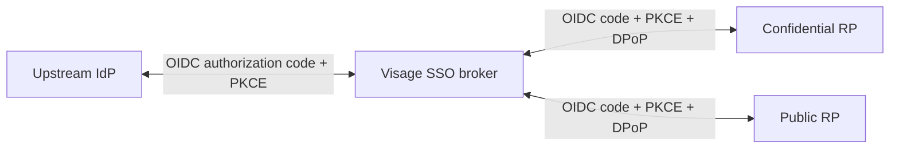

# Visage Authorization

An internal OIDC SSO broker: a relying party (RP) to one upstream identity
provider and an identity provider to downstream applications.



One upstream login establishes a Visage SSO session. Each downstream RP receives
its own authorization code and tokens, then manages its own application session.
Grants are approved without a consent screen.

## Usage

```ts
import { createAuthorizationServer } from '@blakearoberts/visage-authorization';

const handler = await createAuthorizationServer({
  issuer: 'https://sso.example.com',
  clientId: 'visage',
  clientSecret: process.env.SSO_CLIENT_SECRET!,
  redirectUri: 'https://auth.example.com/interaction/callback',
});
```

Mount the returned request handler on an HTTPS Node server. Register the exact
callback URL with the upstream SSO using `client_secret_basic`. Its path must be
`/interaction/callback`; its origin becomes Visage's issuer. Upstream endpoints
and verification keys are discovered through OIDC.

## Downstream clients

Clients publish CIMD documents at their HTTPS client ID URLs, supplying exact
redirect URIs and client metadata. Public clients use `none` authentication;
confidential clients use `private_key_jwt` with `jwks` or `jwks_uri`.

Set `dpop_bound_access_tokens: true` and `id_token_signed_response_alg: ES256`.
Authorization requests require S256 PKCE, `nonce`, and `dpop_jkt`. Refresh
tokens require `refresh_token` in `grant_types` and the `offline_access` scope.
Access-token audience is the downstream client ID. CIMD follows the provider
library's draft-02 profile.

## Operation

Visage generates its signing key at startup and publishes the public key through
JWKS. ID and access tokens expire after one minute. Refresh tokens are
DPoP-bound and rotated. SSO preserves upstream `auth_time`, with a 12-hour
overall limit and 15-minute inactivity limit.

Discovery, authorization, upstream callback, token, and JWKS endpoints are
provided. Protocol policy is fixed; UserInfo and token exchange are unsupported.
Run one process: keys, sessions, and grants are in memory and lost on restart.

## Standards targets

Target [OIDC](https://openid.net/specs/openid-connect-core-1_0.html) federation
with [DPoP](https://www.rfc-editor.org/rfc/rfc9449.html)-bound tokens,
[NIST AAL3](https://pages.nist.gov/800-63-4/sp800-63b.html) upstream
authentication, and FIPS-validated cryptography. Preserve the upstream
authentication time and achieved assurance throughout the downstream flow.
