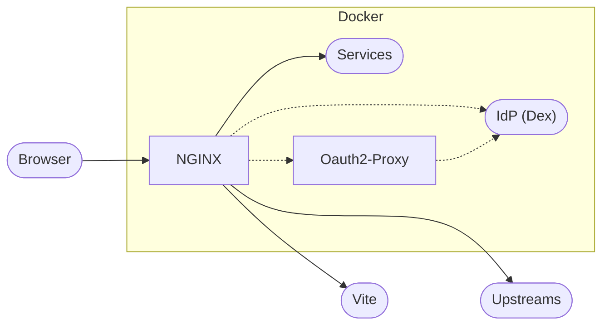

# Visage

Visage (`/vit·ɛdʒ/`) is a Vite plugin for local development with HMR and OIDC
session cookie lifecycle semantics.

## Getting Started

Install Visage from npm:

```console
npm install @blakearoberts/visage@next
```

Add the plugin to `vite.config.ts`:

```ts
import { defineConfig } from 'vite';
import visage from '@blakearoberts/visage';

export default defineConfig({
  plugins: [visage()],
});
```

Start Vite normally:

```console
vite
```

By default, you can reach the app at `https://localhost:9001`. You will be
redirected to Dex to sign in. The default username and password is
`user@example.com` and `pass`.

## Why Visage

Visage is a local development harness for web apps that run behind an
auth-protected edge, where browser sessions are represented by secure cookies
backed by OIDC tokens.

Visage narrows the gap between local development, automated tests, and
production by bringing production-like session lifecycle semantics to local Vite
development without giving up HMR. That makes it practical to iterate on SSR
identity injection, session timeout recovery, lock screens, and authenticated
API calls.

Visage can also use a hosted IdP, so local frontend code can call hosted backend
APIs with real credentials. That avoids frontend-only auth mocks or backend-only
local bypasses: code can be written for production and still work locally.

## System Block Diagram



## Configuration

Visage is configured through `visage(options?)` in `vite.config.ts`.

The top-level `host` and `port` configure the local Visage origin that the
browser visits:

```ts
visage({ host: 'localhost', port: 9001 });
```

### Services

Services are Docker Compose services managed by the Vite dev-server lifecycle.
Additional services automatically configure an upstream with the same name,
host, and `/{name}/` location. Services with a public `host` default to `/`.

```ts
visage({
  services: { whoami: { image: 'traefik/whoami' } },
});
```

#### Service Networks

Each service joins its own private Docker network. NGINX joins the private
networks of services with upstreams. To allow direct service-to-service
connections, add the same network name to each service's `networks` list.

```ts
visage({
  services: {
    api: { image: 'example/api' },
    res: { image: 'mysql', upstream: false, networks: ['api'] },
  },
});
```

### Remotes

Remotes are upstreams without a Visage managed Docker container process. Remotes
automatically configure an upstream with the same host and `/{name}/` location.

```ts
visage({
  remotes: {
    api: { host: 'api.remote.test' },
  },
});
```

Service and remote locations do not forward bearer tokens by default. Set
`auth.forward` to `true` to forward the default bearer token for the upstream
kind: remotes receive the OAuth access token, while services receive the OIDC ID
token.

Hosted backend APIs that validate bearer auth should generally receive the
access token, provided the token is issued for that API's issuer, audience, and
scopes. Use `'access'` or `'id'` when you need to force a specific token kind.

```ts
visage({
  remotes: {
    api: {
      host: 'api.remote.test',
      locations: {
        '/api/v1': { auth: { forward: true } },
      },
    },
  },
});
```

OAuth2 Proxy can also return `X-Auth-Request-Groups` and
`X-Auth-Request-Preferred-Username`, but Visage does not capture or forward them
automatically. Capture and forward optional identity values as needed:

```ts
visage({
  remotes: {
    api: {
      locations: {
        '/api/': {
          directives: {
            auth_request_set: [
              '$auth_groups $upstream_http_x_auth_request_groups',
              '$auth_preferred_username $upstream_http_x_auth_request_preferred_username',
            ],
          },
          headers: {
            'X-Auth-Request-Groups': '$auth_groups',
            'X-Auth-Request-Preferred-Username': '$auth_preferred_username',
          },
        },
      },
    },
  },
});
```

Authenticated locations also get CSRF checks by default. Set `csrf: false` when
the upstream intentionally handles cross-site browser requests itself. See
[CSRF Policy](../../docs/csrf-policy.md).

### External IdPs

The default IdP, Dex, can be replaced with an external OIDC provider:

```ts
visage({
  idp: { issuer: 'https://idp.example.test/oauth2/default' },
});
```

Configure `authorization`, `token`, or `jwks` only when the provider endpoints
must be rendered explicitly instead of discovered from the issuer. Configure
`end_session_endpoint` when the provider supports OIDC end-session redirects.

Visage delegates principal admission to the identity provider and configures
OAuth2 Proxy to accept any non-empty email asserted by that issuer. With managed
Dex, `idp.users` is the complete eligible user list. With an external IdP, its
client registration and application-assignment policy must ensure every identity
that can obtain an OIDC response for the Visage client is intended to access the
local application; Visage does not apply an additional email-domain allowlist.

### Telemetry

Set `telemetry` to enable collection, redaction, and export of telemetry signals
via OTLP/gRPC.

- When enabled, Visage configures:
  - NGINX to export access spans to the Collector;
  - OAuth2 Proxy Prometheus metrics listener to be scraped by the Collector;
  - Service containers to send stdout/stderr to the Collector;
  - The Collector to accept authenticated OTLP/HTTP signals at `/t/`.

- The Collector exports OTLP to `host.docker.internal:4317` by default; the
  [telemetry example](../../examples/telemetry) demonstrates how to configure
  Grafana as a Visage managed service to receive and view the telemetry.

See [`VisageOptions`](src/types.ts) for the full option surface.

## Required Tools

- [Docker](https://docs.docker.com/get-started/get-docker/) with Compose v2
  support through `docker compose`.
- [`mkcert`](https://github.com/FiloSottile/mkcert#installation) installed on
  `PATH`, or configured with `VISAGE_MKCERT=/path/to/mkcert`.

## Managed Docker Images

Visage pulls these as needed based on configuration:

| Service                                                             | Image                                                                                                   |
| ------------------------------------------------------------------- | ------------------------------------------------------------------------------------------------------- |
| [NGINX](https://nginx.org/)                                         | [`visage-nginx`](https://github.com/blakearoberts/visage/pkgs/container/visage-nginx)                   |
| [OAuth2 Proxy](https://oauth2-proxy.github.io/oauth2-proxy/)        | [`quay.io/oauth2-proxy/oauth2-proxy`](https://quay.io/repository/oauth2-proxy/oauth2-proxy)             |
| [Dex](https://dexidp.io/)                                           | [`ghcr.io/dexidp/dex`](https://github.com/dexidp/dex/pkgs/container/dex)                                |
| [OpenTelemetry Collector](https://opentelemetry.io/docs/collector/) | [`otel/opentelemetry-collector-contrib`](https://hub.docker.com/r/otel/opentelemetry-collector-contrib) |
| [Socat](https://www.dest-unreach.org/socat/)                        | [`alpine/socat`](https://hub.docker.com/r/alpine/socat)                                                 |

The image tags Visage uses by default are defined by the manifest file,
[docker-compose.images.yml](docker-compose.images.yml).

## Security Notes

Visage is local-development tooling. It starts local auth infrastructure,
terminates local HTTPS, and forwards authenticated identity or token material to
configured upstreams.

Please report suspected vulnerabilities through GitHub private vulnerability
reporting as described in [Security Policy](../../SECURITY.md).

Do not treat the managed Dex and OAuth2 Proxy defaults as production auth
infrastructure.

Visage's CSRF policy is the edge CSRF control for cookie-backed locations.
Application CSRF tokens are not required for ordinary same-origin SPA mutations
under this policy. App-level tokens may still be useful when a location disables
the edge policy, intentionally accepts cross-site browser requests, or needs a
token that encodes additional authorization semantics. CSP, `frame-ancestors`,
and other click-jacking controls remain application policy.

## Troubleshooting

- If startup fails immediately, confirm Docker is running and `docker compose`
  works.
- If NGINX cannot start, check whether the configured `port` is already in use.
- If the hostname cannot be resolved, Visage may need permission to update
  `/etc/hosts`.
